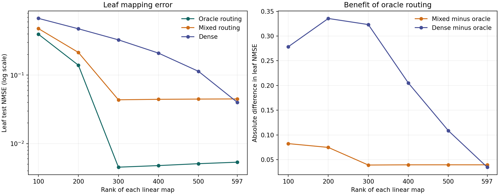

# 容量曲线与全矩阵对照

固定 K=2、输入 3584 维、输出 597 维、六专家中每次激活两个。三种路由/架构共用教师、样本流、优化器和 6000 步预算。下表为三个配对种子的末步叶分量测试 NMSE。每次测试 49152 个单分量样本；指定及混合组使用原路径或原替代路径。图中阴影为种子极差。

|秩|指定|混合|Dense|混合−指定|Dense−指定|
|---:|---:|---:|---:|---:|---:|
|100|0.39665|0.47915|0.67494|0.08250|0.27829|
|200|0.13977|0.21457|0.47532|0.07480|0.33555|
|300|0.00453|0.04368|0.32775|0.03915|0.32322|
|400|0.00478|0.04438|0.20983|0.03959|0.20504|
|500|0.00510|0.04474|0.11364|0.03964|0.10854|
|597|0.00536|0.04497|0.04006|0.03961|0.03470|
|直接全矩阵|0.00635|0.05391|0.04033|0.04756|0.03398|

直接全矩阵与秩 597 因子化有相同最大可表示秩，训练参数化不同；前者单列表格。指定与混合的专家参数量、激活预算、负载相同；Dense 与两组的总参数量不同。数值仅适用于固定教师、训练预算与该输入分布。逐种子、各分量数据见 [CSV](test_by_seed.csv)。

## 结论

在所有秩点，指定路由均比相同参数和负载的强制混合路由更好地恢复叶分量。秩 300 时，分开处理将叶误差减少 0.03915，common 误差减少约 0.00985。压到秩 100 后，叶误差的绝对差增至 0.08250，但两组的叶误差都已相当高；倍数改善并未随瓶颈加重而提高。秩 300 至 597 时，绝对差稳定在约 0.04。直接全矩阵对照仍有 0.04756 的差距。综合判断是低秩会加重错误共享的代价，但在当前线性模型和固定训练预算下，放开秩并未消除指定路由收益。路径标签能选择不同线性映射；单纯提高矩阵秩不会自动赋予没有路径信息的线性函数同样的条件计算能力。本实验未单独识别这一机制与优化误差的贡献。
